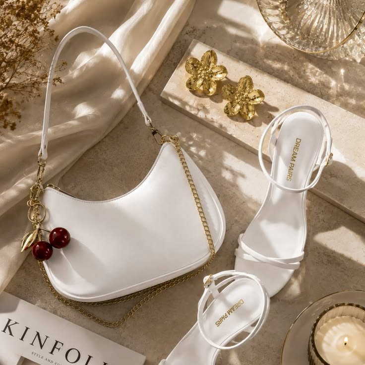

<div align="center">
  

  # NOVA — Everyday Essentials

  A refined, responsive storefront experience for timeless everyday accessories.

  
  
</div>

---

## Preview

<p align="center">
  
</p>


## Live Demo

[View the NOVA landing page](https://hanaelnegery1.github.io/NOVA-Landing-Page/)


## About the Page

**NOVA — Everyday Essentials** is a modern single-page fashion landing page inspired by calm, minimalist design. It presents a curated collection of bags, watches, sunglasses, and accessories through warm neutral colors, elegant typography, and spacious product layouts.

## Page Sections

| Section | Description |
| --- | --- |
| Hero | Introduces the NOVA collection and primary shopping actions |
| Categories | Provides quick access to bags, watches, sunglasses, and accessories |
| Featured Products | Highlights the most-loved pieces and their prices |
| Brand Values | Presents quality, curated selection, and timeless style |
| About | Shares NOVA's story and design philosophy |
| Call to Action | Promotes the collection and first-order delivery offer |
| Footer | Contains quick links, contact information, and social links |

## Design Highlights

- Responsive desktop, tablet, and mobile layouts
- Elegant serif headings paired with clean sans-serif text
- Warm beige, taupe, charcoal, and white color palette
- CSS-only mobile navigation
- Smooth scrolling and polished hover interactions
- Product, category, story, and promotional imagery
- Semantic HTML with accessible navigation and image descriptions

## Built With

- HTML5
- CSS3
- CSS Grid and Flexbox
- Responsive media queries

## Project Structure

```text
NOVA-Landing-Page/
├── index.html
├── README.md
├── css/
│   └── style.css
└── assets/
    └── images/
        ├── logo.png
        ├── hero.jpeg
        ├── about.jpeg
        ├── category-bags.jpeg
        ├── category-watches.jpeg
        ├── category-sunglasses.jpeg
        ├── category-accessories.jpeg
        ├── product-1-bag.jpeg
        ├── product-2-watch.jpeg
        ├── product-3-sunglasses.jpeg
        └── product-4-holder.jpeg
```
